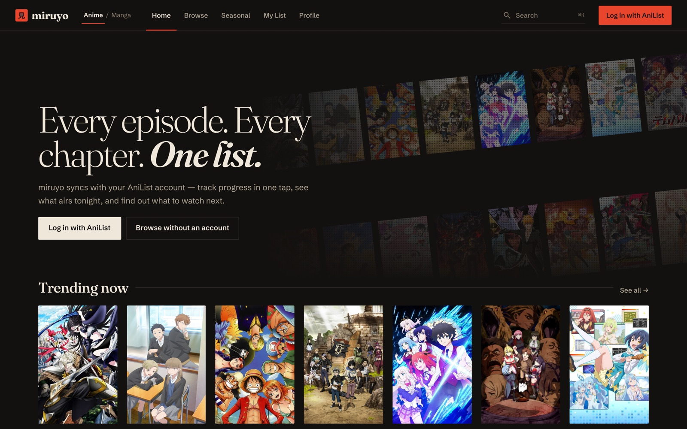
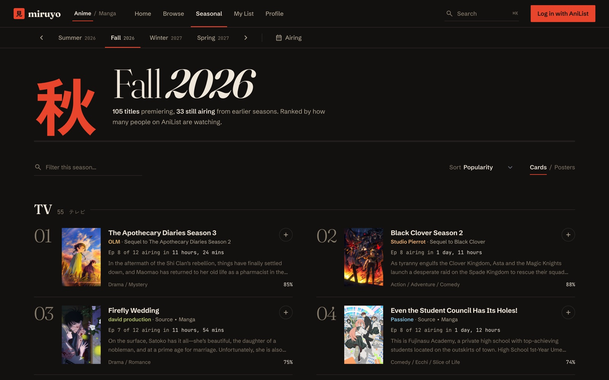

# miruyo

A fast front end for your [AniList](https://anilist.co) anime and manga list: one-tap progress, what's airing next, and what's trending this season.

**Live at [miruyo.jnagra.com](https://miruyo.jnagra.com).** Sign in with your AniList account; everything you change is saved straight to AniList.



| A title page                                                                                                                 | The season chart                                                                                        |
| ---------------------------------------------------------------------------------------------------------------------------- | ------------------------------------------------------------------------------------------------------- |
|  |  |

## What it does

- **Track in one tap.** Home leads with what you're behind on, and +1 logs an episode or chapter from anywhere. Edits show at once and sync to AniList.
- **Know what's airing.** The season chart, the week's schedule in your own time zone, and countdowns to the next episode.
- **Find what's next.** For You picks from the titles you rated highest, each saying why; trending and popular rows; search with AniList's filters.
- **Anime and manga.** One switch changes the whole site between them.
- **Your stats and profile**, people's lists, staff, characters and studios.

**Built with** SvelteKit (Svelte 5) and Tailwind CSS v4, on Cloudflare Workers. It calls AniList's public GraphQL API straight from the browser: there's no miruyo server or database.

## Running it yourself

```sh
npm install
cp .env.example .env   # then set PUBLIC_ANILIST_CLIENT_ID
npm run dev
```

You need your own AniList API client, from [anilist.co/settings/developer](https://anilist.co/settings/developer), with the redirect URL `http://localhost:5173/api/callback`. [CONTRIBUTING.md](CONTRIBUTING.md) has the details and the checks to run, and [docs/architecture.md](docs/architecture.md) is a tour of the code.

To publish your own copy on [Cloudflare Workers](https://developers.cloudflare.com/workers/) (the free plan is enough):

1. In the Cloudflare dashboard, go to **Workers & Pages → Create → Import a repository**, and pick your fork. The build command is `npm run build` and the deploy command `npx wrangler deploy`.
2. Under the Worker's **Settings → Build → Variables**, set:
   - `PUBLIC_ANILIST_CLIENT_ID`: a second AniList client whose redirect URL is `https://<your domain>/api/callback`.
   - `PUBLIC_SITE_URL`: your site's address, such as `https://example.com`, used for canonical links, share cards, the sitemap and robots.txt. The build fails without it.
3. Under **Settings → Domains & Routes**, add your domain.

Then put your own name and contact details in `src/lib/legal.ts`, which the Privacy Policy and Terms read from. To deploy from your own machine instead, run `npx wrangler login` once, then `npm run build && npx wrangler deploy` with both variables set.

## Contributing

Issues and pull requests are welcome. Read [CONTRIBUTING.md](CONTRIBUTING.md) first; everyone taking part follows the [code of conduct](CODE_OF_CONDUCT.md). Report security problems privately, as [SECURITY.md](SECURITY.md) describes. What's planned is in [ROADMAP.md](ROADMAP.md), and what changed in [CHANGELOG.md](CHANGELOG.md).

## Credits

- Data and cover art come from [AniList](https://anilist.co) through its public API. **miruyo is an unofficial client: it isn't affiliated with or endorsed by AniList.**
- Fonts: [Fraunces](https://github.com/undercasetype/Fraunces), [Schibsted Grotesk](https://github.com/schibsted/schibsted-grotesk) and [JetBrains Mono](https://github.com/JetBrains/JetBrainsMono), under the SIL Open Font License. Icons: [Material Symbols](https://fonts.google.com/icons), under the Apache License 2.0.

## Licence

[MIT](LICENSE) © Jasanpreet Nagra
